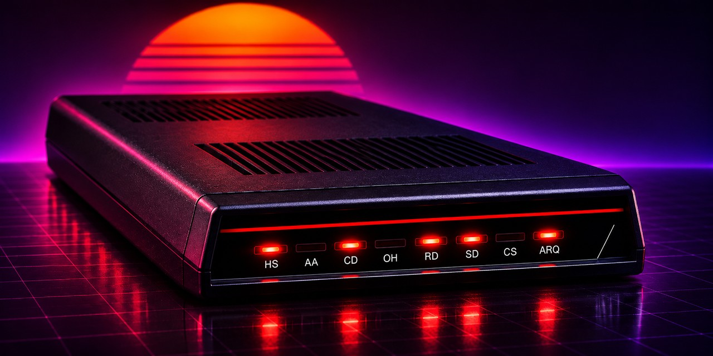
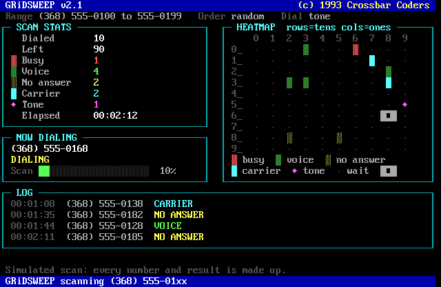
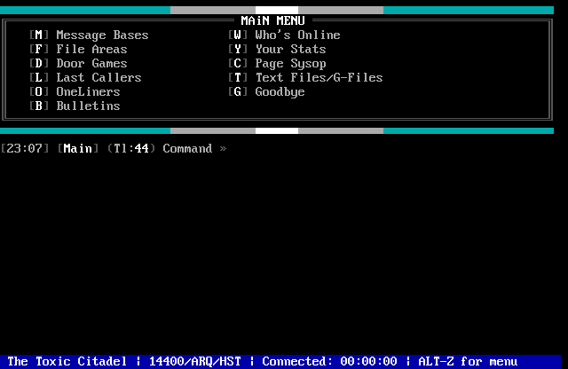
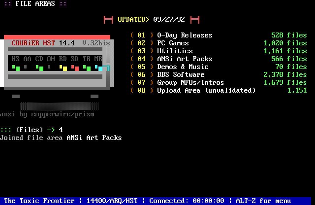
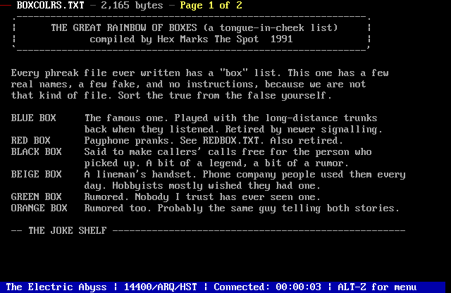

# courierhst
sleek. sharp. black.

A Linux console screensaver with **2 screensaver modes**:

- the **BBS** screen (default, `--bbs`): dials and browses fictional
  early-1990s warez-scene BBSes on a **US Robotics Courier HST 14.4**
- the **GRiDSWEEP** dialer (`--dialer`): an invented 1993 number-scan
  animation

Press `d` for the dialer and `b` for the BBS, or use `--rotate MINUTES` to
swap between them automatically.

All BBS output is metered at a real 14,400 bps (1,440 cps, 8N1), so every ANSI
logo, menu and file listing paints in at true modem speed. Each call:

- **Dials**: `ATZ`, init string, `ATDT`, sometimes `BUSY` and a redial, then
  `CONNECT 14400/ARQ/HST`
- **Logs in**: ANSI detection, a block-letter logo, handle/password check,
  logon stats, mail scan, last callers, oneliners
- **Browses** period menus in four flavours (Renegade-, Telegard-, Mystic- and
  PCBoard-style): message bases, file areas (multi-disk 8.3 ZIP sets, Zmodem
  transfers), door games (**Shadowmire**, **Starlane Merchant**), bulletins,
  who's online, paging the sysop
- **Logs off**: goodbye screen, `NO CARRIER`, then dials the next board

A status bar (connect speed, board name, online timer) sits under the 80x25
window, which is centred in larger terminals. There is occasional line noise.

Every board, handle, group, release title and door game is fictional.

## Screenshots

Rendered headlessly from the app's own output.




The four board styles, each at its main menu:

| Renegade | Telegard |
|---|---|
|  |  |
| **Mystic** | **PCBoard** |
|  |  |

A splash logo, a file area with ANSI art, a G-Files page and the status bar:






To regenerate them: `pip install '.[media]'`, then `python3 tools/render_media.py --out docs/media`.

Font: Px437 IBM VGA 8x16 from The Ultimate Oldschool PC Font Pack by VileR (int10h.org), CC BY-SA 4.0 (licence in `tools/fonts/LICENSE.txt`).

## Install

**Requirements:** Python 3.8+ on Linux, a terminal of at least 80x25, and a
VGA/CP437-style font for the best look (e.g. "Perfect DOS VGA 437", or
`setfont default8x16` on the console).

**Quick install** (no sudo, per-user):

```sh
./install.sh              # pipx if present, else pip --user
./install.sh --dry-run    # only print what it would run
./install.sh --uninstall  # remove it again
```

**Debian and Ubuntu:** use pipx. The system Python is "externally managed"
(PEP 668), so `pip install --user` is refused; `install.sh` says so and exits
with code 3 when pipx is missing:

```sh
sudo apt install pipx && ./install.sh
```

The script never edits your shell rc files; it says if `PATH` needs the bin directory.

**Manual install:**

```sh
pipx install .            # or: pip install --user .
courierhst
python3 -m courierhst     # or run straight from the checkout, no install
```

**Uninstall:** `./install.sh --uninstall`, or `pipx uninstall courierhst` /
`pip uninstall courierhst`.

**Extras:** `pip install '.[test]'` (tests), `pip install '.[media]'` (screenshots).

## Run

```sh
courierhst                # once installed (see Install)
python3 -m courierhst     # from the repo, no dependencies
```

Press any key to exit; `d` and `b` switch screens (see Dialer screensaver).

| option | |
|---|---|
| `--bps N` | line speed (default 14400; try 2400 for pain) |
| `--handle NAME` | your handle (default: random) |
| `--seed N` | repeatable run |
| `--noise P` | line-noise chance per character (default 0.0007, 0 = off) |
| `--xfer-speedup X` | time compression for Zmodem downloads (default 40, 1 = real time) |
| `--no-center` / `--no-status` | draw at top-left / hide the status bar |
| `--calls N` | exit after N calls (default: forever) |
| `--step-pause SECONDS` | seconds the caller lingers before each next step: menu command, message, file prompt, door move (default 5, 0 disables; `--warp` scales it) |
| `--warp X` | speed everything up (for previewing) |
| `--board-style S` | force the BBS software style: `renegade`, `telegard`, `mystic` or `pcboard` (default: random mix) |
| `--bbs` / `--dialer` / `--rotate MINUTES` | choose the start screen / swap screens every MINUTES (see Dialer screensaver) |
| `--no-exit-on-key` | only Ctrl-C exits (`d` and `b` still switch screens) |

## Dialer screensaver

**GRiDSWEEP** is an invented 1993 number-scan animation: a stats panel, the
number being dialed, a 10x10 results heatmap and a scrolling log. Simulation
only: it never touches a modem, port or network and makes no real calls. Every
number is a fictional 555-01xx one.

- `d` switches to the dialer, `b` to the BBS; any other key exits
- `courierhst --bbs` / `courierhst --dialer`: choose the start screen
- `courierhst --dialer --rotate 10`: start on the dialer, swap every 10 minutes

## Use it as a screensaver

tmux (any terminal or the Linux console), in `~/.tmux.conf`:

```tmux
set -g lock-after-time 300          # idle seconds
set -g lock-command "courierhst"
```

zsh without tmux (bash's `TMOUT` logs out instead, so use tmux there):

```zsh
TMOUT=300
TRAPALRM() { courierhst }
```

## G-Files (text files)

Every board has a *Text Files/G-Files* entry (`T`, or `TF` on PCBoard) with
scene NFOs, BBS lists, rants and humor. To add your own, drop a plain ASCII or
CP437 `.txt` file (at most 79 columns per line) into
`courierhst/data/gfiles/<section>/` (`scene`, `bbs`, `rants`, `misc`, or a new
folder for a new section). Optionally add a line to that folder's `files.bbs`
(filename, then a description of up to 45 characters); otherwise the file's
first non-blank line is used. No code changes are needed.

## Development

The program itself has no dependencies (stdlib only, Python 3.8+):

```sh
python3 -m unittest discover -s tests
```

The pty acceptance tests need the `pyte` VT emulator and are skipped without
it; `pip install '.[test]'` (in a virtualenv) provides it. The foundry gate in
`foundry.json` does that in a fresh venv, then runs the suite with
`COURIERHST_REQUIRE_PYTE=1`, which turns a missing `pyte` into a hard error
instead of a skip:

```sh
python3 -m venv "$TMPDIR/v" && "$TMPDIR/v"/bin/pip install -q '.[test]' && COURIERHST_REQUIRE_PYTE=1 "$TMPDIR/v"/bin/python -m unittest discover -s tests -t .
```
