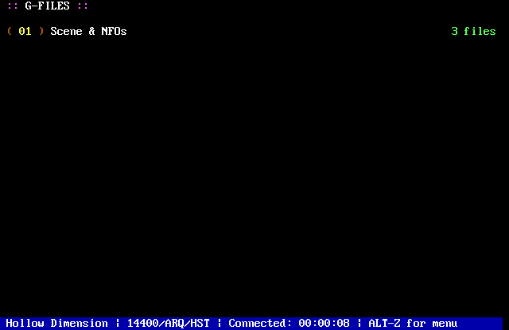
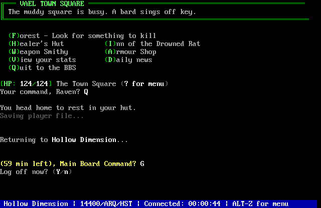
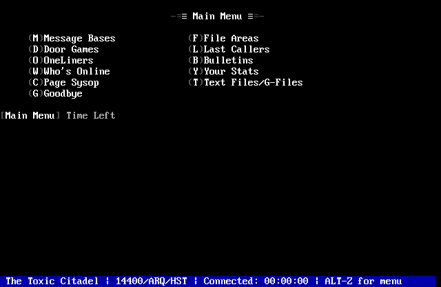
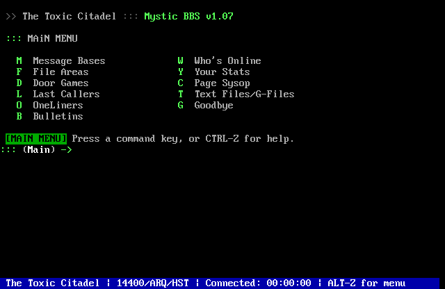
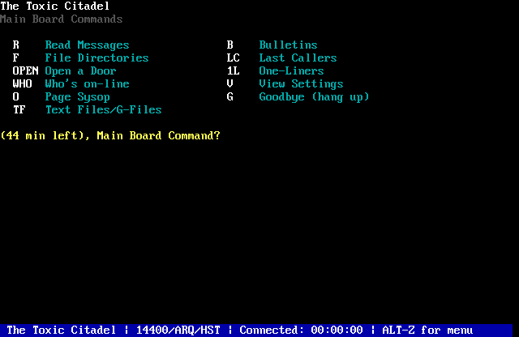
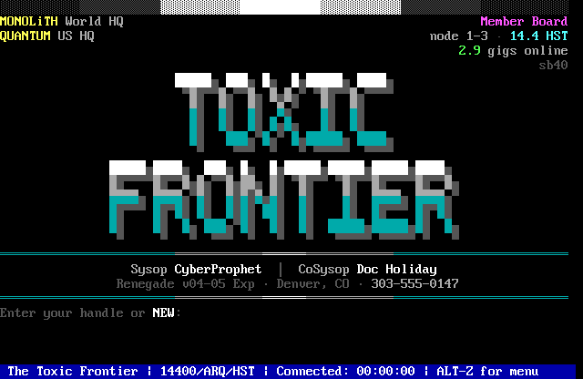

# courierhst
sleek. sharp. black.

A Linux console screensaver that dials up early-1990s warez-scene BBSes on a
**US Robotics Courier HST 14.4** and browses them for you. All output is
metered at a real 14,400 bps (1,440 cps, 8N1), so every ANSI logo, menu and
file listing paints in at true modem speed.

Each call:

- **Dials** from the terminal program: `ATZ`, init string, `ATDT`, sometimes
  `BUSY` and a redial, then `CONNECT 14400/ARQ/HST`
- **Logs in**: mailer "press ESC twice", ANSI detection, a block-letter ANSI
  logo with gradients and drop shadows, handle/password/phone check, logon
  stats, mail scan, last callers, oneliners
- **Browses** with period menus in four flavours (Renegade-, Telegard-, Mystic- and
  PCBoard-style), picking from:
  - message bases (scene chatter, courier wanted ads, FS: modems, origin lines)
  - file areas: 0-day and game releases as multi-disk 8.3 ZIP sets with group
    tags, then flag, pick Zmodem, and watch the transfer window at about 1,650 cps
  - door games: **Shadowmire** (forest-fight RPG) and **Starlane Merchant**
    (space trading with haggling)
  - bulletins and rules, who's online, your stats, paging the sysop
- **Logs off**: goodbye screen, `NO CARRIER`, and dials the next board

A terminal-program status bar (connect speed, board name, online timer) sits
under the 80x25 BBS window. The window is centred in larger terminals. There
is occasional line noise.

Each board's logo is drawn in one of four styles, picked at random per board:
the 5x5 half-block letters, chunky 7-row letters with a drop shadow, chunky
letters dithered with `░▒▓` towards the bottom, or thin line-art lettering
made of `/ \ _ |` (`courierhst/logos.py`).

The boards also show original ANSI art pieces (skull, modem, floppy, dragon,
starship, phone) by fictional artists (`courierhst/art.py`).

Every board, handle, group, release title and door game is fictional.

## Screenshots

Rendered headlessly from the app's own output, not screen recordings.

**Dial-in:** dial, `CONNECT`, the splash and login, up to the main menu, at real 14.4k speed.


**Browsing:** a G-Files text file painting in a page at a time.



**Goodbye:** the goodbye screen and `NO CARRIER`.



The four board styles, each at its main menu:

| Renegade | Telegard |
|---|---|
|  |  |
| **Mystic** | **PCBoard** |
|  |  |

More:

-   
  A board's ANSI splash logo.
-   
  The file areas screen with an ANSI art panel.
-   
  A G-Files reader page.
-   
  The terminal-program status bar under the 80x25 window.

To regenerate them: `pip install '.[media]'`, then `python3 tools/render_media.py --out docs/media`.

Font: Px437 IBM VGA 8x16 from The Ultimate Oldschool PC Font Pack by VileR (int10h.org), CC BY-SA 4.0 (licence in `tools/fonts/LICENSE.txt`).

## Install

**Requirements:** Python 3.8+ on Linux, a terminal of at least 80x25, and a
VGA/CP437-style font for the best look (e.g. a "Perfect DOS VGA 437"-style
font).

**Quick install** (no sudo, per-user):

```sh
./install.sh              # pipx if present, else pip --user
./install.sh --dry-run    # only print what it would run
./install.sh --uninstall  # remove it again
```

The script checks your Python version, installs, and tells you if the bin
directory needs adding to `PATH`. It never edits your shell rc files.

**Manual install:**

```sh
pipx install .            # or: pip install --user .
courierhst
python3 -m courierhst     # or run straight from the checkout, no install
```

**Uninstall:** `./install.sh --uninstall`, or `pipx uninstall courierhst` /
`pip uninstall courierhst`.

**Optional extras:** `pip install '.[test]'` adds `pyte` and `Pillow` for running the tests; `pip install '.[media]'` is for regenerating the screenshots.

## Run

```sh
python3 -m courierhst          # from the repo, no dependencies
# or, once installed (see Install)
courierhst
```

Press any key to exit.

| option | |
|---|---|
| `--bps N` | line speed (default 14400; try 2400 for pain) |
| `--handle NAME` | your handle (default: random) |
| `--seed N` | repeatable run |
| `--noise P` | line-noise chance per character (default 0.0007, 0 = off) |
| `--xfer-speedup X` | time compression for Zmodem downloads (default 40, 1 = real time) |
| `--no-center` / `--no-status` | draw at top-left / hide the status bar |
| `--calls N` | exit after N calls (default: forever) |
| `--step-pause SECONDS` | seconds the caller lingers before each next step: menu command, message, file prompt, door move (default 5, 0 disables; `--warp` scales it) |
| `--warp X` | speed everything up (for previewing) |
| `--board-style S` | force the BBS software style: `renegade`, `telegard`, `mystic` or `pcboard` (default: random mix) |
| `--no-exit-on-key` | only Ctrl-C exits |

The art uses CP437 block and box characters, which the Linux console's
default fonts and any modern terminal font can display. For the authentic
look, use a VGA font (e.g. `setfont` with a `Lat2-VGA16` / `default8x16` font
on the console).

## Use it as a screensaver

**tmux** (works on the Linux console and in any terminal):

```tmux
set -g lock-after-time 300          # idle seconds
set -g lock-command "courierhst"
```

**zsh** (bare Linux console, no tmux):

```zsh
TMOUT=300
TRAPALRM() { courierhst }
```

(bash's `TMOUT` logs the shell out instead of running a hook, so on bash use
tmux.)

## G-Files (text files)

Every board has a *Text Files/G-Files* entry (`T`, or `TF` on PCBoard) that
browses a small library of old-school text files: scene NFOs, BBS lists and
ads, rants and humor. To add your own, drop a plain ASCII or CP437 `.txt` file
(at most 79 columns per line) into `courierhst/data/gfiles/<section>/`, where
`<section>` is `scene`, `bbs`, `rants` or `misc`. A new folder makes a new
section. Optionally add a line to that folder's `files.bbs` (filename, then a
description of up to 45 characters); without one, the first non-blank line of
the file is used. No code changes are needed.

## Development

The program itself has no dependencies (stdlib only, Python 3.8+). Run the
tests with:

```sh
python3 -m unittest discover -s tests
```

The unit tests (`ansi`, `modem.Line` metering and status bar) need nothing
extra. The pty acceptance tests (`tests/test_session_pty.py`) run the whole
program for seeds 1-20 at 80x26, 80x24 and 120x40 and check the output with
the `pyte` VT emulator; they are skipped if `pyte` is missing. Install it
with `pip install pyte` (or `pip install -e '.[test]'`). The full pty run
takes about 30 seconds.

To get `pyte` along with the project, run `pip install '.[test]'` (use a
virtualenv). The foundry gate in `foundry.json` does exactly that in a fresh
venv and then runs the suite:

```sh
python3 -m venv "$TMPDIR/v" && "$TMPDIR/v"/bin/pip install -q '.[test]' && COURIERHST_REQUIRE_PYTE=1 "$TMPDIR/v"/bin/python -m unittest discover -s tests -t .
```

`COURIERHST_REQUIRE_PYTE=1` makes a missing `pyte` a hard error (importing the
`tests` package raises `ImportError`) instead of silently skipping the pty
tests. Leave it unset for normal local runs; only the gate sets it.
